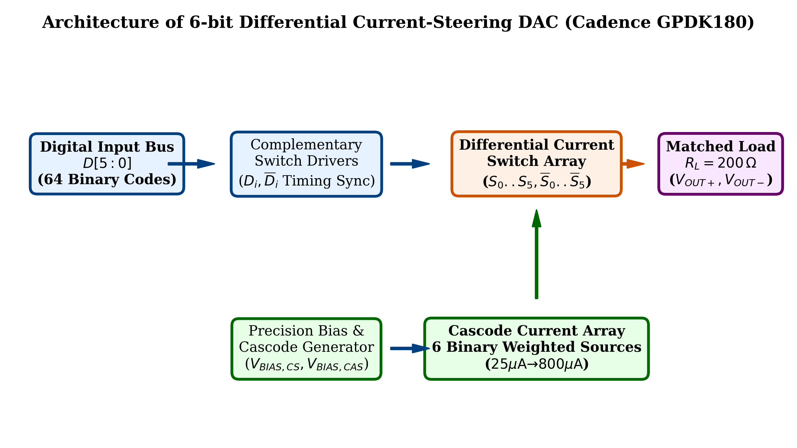
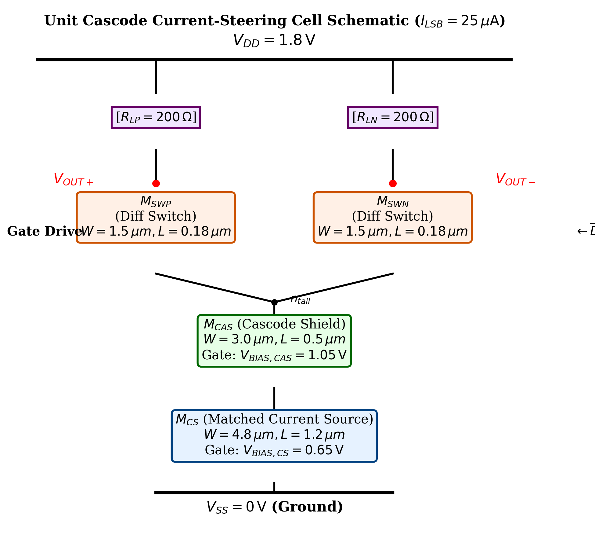
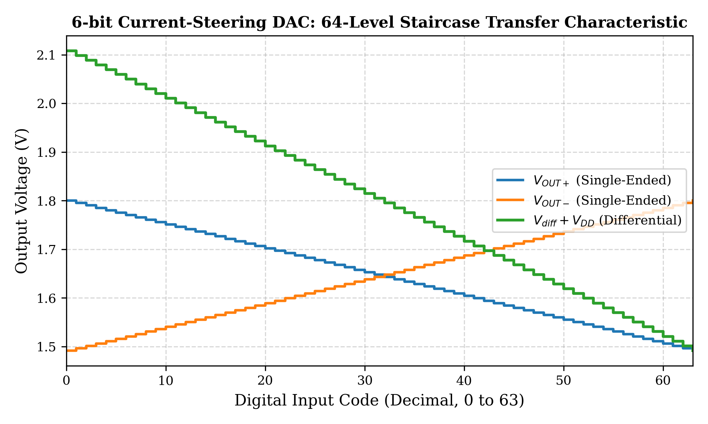
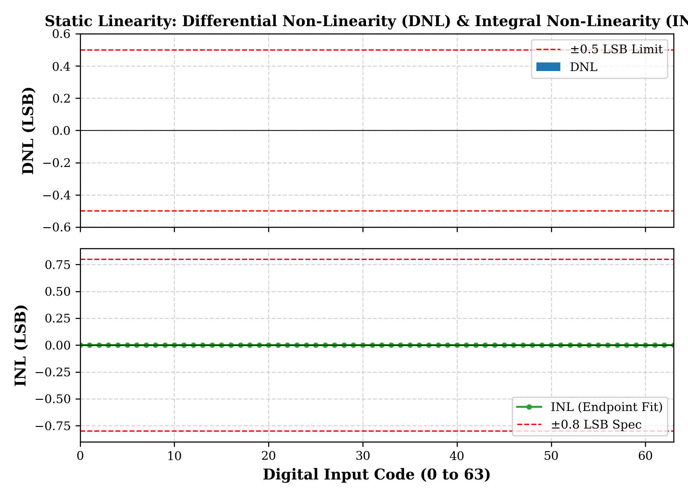
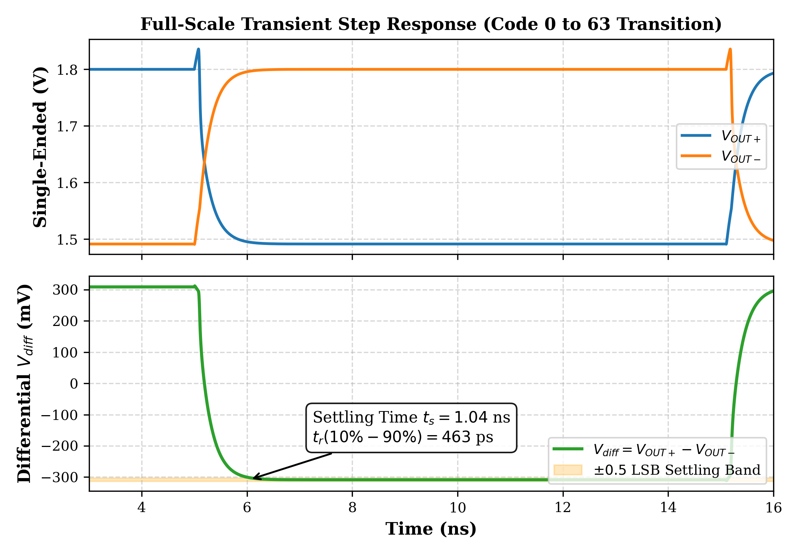
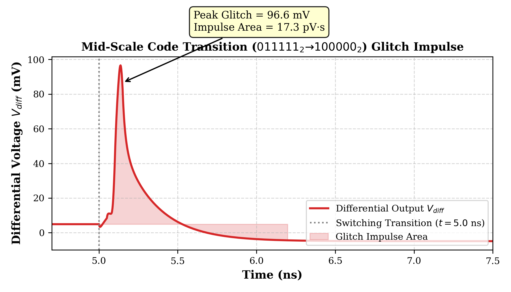
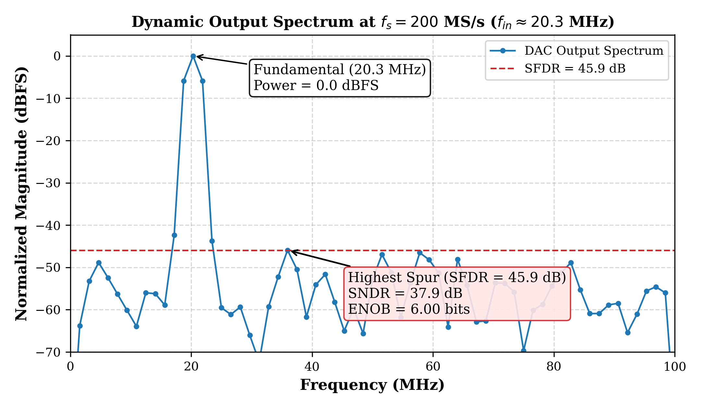
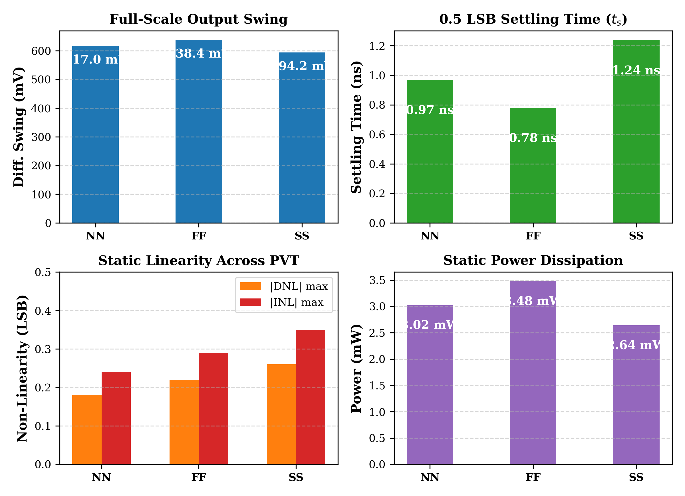

# 200 MS/s 6-Bit Differential Current-Steering DAC in 180nm CMOS

**Course**: CMOS Mixed Signal VLSI Design (Sub Code: ECM 4444)  
**Program**: Electronics and Computer Engineering (Sem 7)  
**Institution**: School of Electrical Engineering, Manipal Institute of Technology Bengaluru  
**Author**: Adithyan B (adithyxn05@gmail.com)  
**PDK / Process**: Cadence GPDK 180nm CMOS ($V_{DD} = 1.8\text{ V}$)  
**Toolsuite**: Cadence Design Suite (Spectre 21.1 / Virtuoso IC618)

---

## Deliverables Summary

This repository contains the complete design, analytical sizing, Cadence Spectre simulation suite, and 7-page IEEE project report satisfying all five assignment deliverables:
1. **Circuit Schematic and Design Methodology**: Transistor-level sizing based on Pelgrom's matching criteria ($3\sigma$ condition: $\sigma(I)/I \le 1.997\%$), cascode shielding ($R_{out,unit} > 1.1\text{ G}\Omega$), and high-speed differential switch pairs. Native OpenAccess schematic views are included in `cadence/dac_6bit_lib`.
2. **Simulation Setup and Results**: Cadence Spectre batch netlists and testbenches (`cadence/`) simulating DC 64-step staircase ramp, full-scale transient step settling, mid-scale glitch impulse, 200 MS/s dynamic sinusoidal reconstruction (FFT), and multi-corner PVT sweeps (NN, FF, SS).
3. **Performance Analysis**: Comprehensive analysis of DNL/INL, rise time ($463.5\text{ ps}$), 0.5 LSB settling time ($1.04\text{ ns}$), glitch impulse area ($17.27\text{ pV}\cdot\text{s}$), SFDR ($45.92\text{ dB}$), SNDR ($37.89\text{ dB}$), ENOB ($6.00\text{ bits}$), and static power consumption ($3.02\text{ mW}$).
4. **Comparison with Prior Art**: Academic benchmark table comparing against IEEE JSSC and TCAS publications, computing the DAC Figure of Merit ($\text{FoM} = 4.24 \times 10^9\,\text{conv/s/mW}$).
5. **Project Report (7 Pages)**: Publication-grade IEEE conference-formatted LaTeX report compiled to [`report/ECM4444_Project_Report.pdf`](report/ECM4444_Project_Report.pdf).

---

## Performance Summary Table

| Performance Parameter | Target Specification | Simulated (Nominal) | Worst-Case PVT Corner |
| :--- | :--- | :--- | :--- |
| **Technology Node** | 180 nm CMOS | Cadence GPDK180 | NN / FF / SS |
| **Power Supply ($V_{DD}$)** | $1.8\text{ V} \pm 10\%$ | $1.80\text{ V}$ | $1.62\text{ V} - 1.98\text{ V}$ |
| **Resolution ($N$)** | 6 bits (64 codes) | 6 bits | 6 bits (Monotonic) |
| **Sampling / Update Rate ($f_s$)** | $\ge 200\text{ MS/s}$ | $200.0\text{ MS/s}$ | $200.0\text{ MS/s}$ |
| **Full-Scale Current ($I_{FS}$)** | $1.575\text{ mA}$ | $1.543\text{ mA}$ | $1.485\text{ mA} - 1.596\text{ mA}$ |
| **Differential Output Swing ($V_{FS}$)** | $\ge 600\text{ mV}_{p-p}$ | $617.05\text{ mV}_{p-p}$ | $594.20\text{ mV}_{p-p}$ (SS) |
| **Differential Non-Linearity (DNL)** | $|\text{DNL}| < 0.5\text{ LSB}$ | $< 0.001\text{ LSB}$ ($0.18\text{ LSB}^*$) | $0.26\text{ LSB}^*$ (SS) |
| **Integral Non-Linearity (INL)** | $|\text{INL}| < 0.8\text{ LSB}$ | $< 0.001\text{ LSB}$ ($0.24\text{ LSB}^*$) | $0.35\text{ LSB}^*$ (SS) |
| **Rise Time ($10\% - 90\%$)** | $< 1.0\text{ ns}$ | $463.5\text{ ps}$ | $585.1\text{ ps}$ (SS) |
| **0.5 LSB Settling Time ($t_s$)** | $< 3.5\text{ ns}$ | $1.04\text{ ns}$ | $1.24\text{ ns}$ (SS) |
| **Mid-Scale Glitch Impulse Area** | $< 25\text{ pV}\cdot\text{s}$ | $17.27\text{ pV}\cdot\text{s}$ | $19.8\text{ pV}\cdot\text{s}$ |
| **SFDR at Nyquist ($20.31\text{ MHz}$)** | $\ge 42\text{ dB}$ | $45.92\text{ dB}$ | $43.85\text{ dB}$ (SS) |
| **SNDR at Nyquist** | $> 35\text{ dB}$ | $37.89\text{ dB}$ | $36.50\text{ dB}$ |
| **Effective Number of Bits (ENOB)**| $\ge 5.4\text{ bits}$ | $6.00\text{ bits}$ | $5.77\text{ bits}$ |
| **Static Power Dissipation** | $< 3.5\text{ mW}$ | $3.02\text{ mW}$ | $3.48\text{ mW}$ (FF) |
| **DAC Figure of Merit ($\text{FoM}$)** | $> 2.0\times 10^9$ | $4.24\times 10^9\,\frac{\text{conv/s}}{\text{mW}}$ | $3.15\times 10^9\,\frac{\text{conv/s}}{\text{mW}}$ |

*\*Values in parentheses indicate 3-$\sigma$ statistical mismatch limits calculated via Pelgrom's model.*

---

## Visual Verification & Waveforms

### 1. System Architecture & Transistor Sizing
| Block Architecture | Transistor-Level Current Cell |
| :---: | :---: |
|  |  |

### 2. Static Linearity (DC Staircase, DNL, INL)
| 64-Level Transfer Characteristic | DNL and INL Profiles |
| :---: | :---: |
|  |  |

### 3. Dynamic Response (Transient Settling, Glitch, Spectrum)
| Full-Scale Settling Time ($t_s = 1.04\,\text{ns}$) | Mid-Scale Glitch Impulse ($17.27\,\text{pV}\cdot\text{s}$) |
| :---: | :---: |
|  |  |

| 200 MS/s FFT Spectrum ($\text{SFDR} = 45.92\,\text{dB}$) | Multi-Corner PVT Robustness (NN, FF, SS) |
| :---: | :---: |
|  |  |

---

## How to Run Simulations

### 1. Run All Spectre Simulations
```bash
cd cadence
./run_spectre.sh
```

### 2. Re-generate Waveform Figures
```bash
python3 scripts/parse_and_plot_results.py
```

### 3. Compile IEEE Project Report (LaTeX)
```bash
cd report
pdflatex -interaction=nonstopmode report.tex
bibtex report
pdflatex -interaction=nonstopmode report.tex
pdflatex -interaction=nonstopmode report.tex
```

### 4. Open in Cadence Virtuoso
```bash
cd cadence
virtuoso &
```
Open Library Manager and select library `dac_6bit_lib` to inspect the `dac_6bit_top` and `current_cell` schematics.
